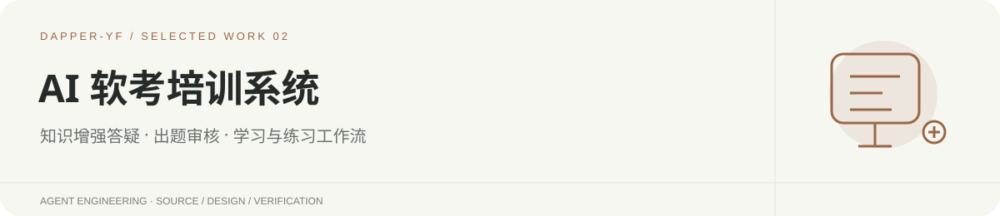
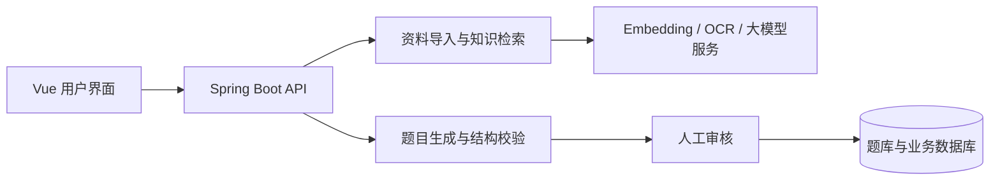

<p align="center"></p>

# AI 软考培训系统

面向软考备考场景的 AI 应用，连接资料导入、知识检索、答疑、练习生成与人工审核。

**作者：严峰 · 企业项目实习期间独立开发 · 公开源码展示版**

[后端代码](backend/platform-application/src/main/java/com/aiexam/app) · [前端代码](frontend/src) · [测试](backend/platform-application/src/test) · [本地运行](#本地运行) · [公开范围](#公开范围与当前限制)

## 项目背景与我的工作

在实习期间独立开发，供 4 人内部试用。我的工作覆盖资料处理与检索、带来源的 AI 答疑、结构化出题与人工审核流程，以及前后端集成。

这份仓库提供可供阅读和构建的代码快照。内部试用规模来自作者项目经历，不代表公开版的性能基准；本次发布未重新进行企业环境的完整验收。

## 重点看什么

| 能力 | 实现入口 | 设计重点 |
| --- | --- | --- |
| 知识增强答疑 | [AI 助手模块](backend/platform-application/src/main/java/com/aiexam/app/aiassistant) | OCR、切片、向量化与混合检索，结合题目和历史生成带来源的回答 |
| 练习生成与审核 | 同目录的 `AiQuestionGenerationService` / `AiQuestionGenerationAdminController` | 校验模型输出，保存待审核草稿，经人工审核进入题库 |
| 基础能力与工程边界 | [模块说明](backend/README.md) | 多模块 Spring Boot、统一接口、数据校验与数据库迁移 |
| 前端交互 | [Vue 源码](frontend/src) | 资料、答疑、练习和审核界面 |

## 技术栈

Java 17 · Spring Boot 3.3 · LangChain4j · Vue 3 · TypeScript · MySQL · Redis · Qdrant



## 本地运行

准备 JDK 17、Maven 3.9，以及 Node.js 22.19 / npm 10.9。所有命令在本仓库目录执行，不依赖作者电脑的绝对路径。

### 1. 构建后端（已验证）

```powershell
cd backend
mvn -DskipTests package
```

2026-10-15 已在隔离副本完成 Maven 打包，七个模块均构建成功（跳过测试）。构建产物为 `platform-application/target/platform-application-0.1.0-SNAPSHOT.jar`。

**当前公开版存在启动前置条件**：默认 H2 配置未提供完整认证表结构，直接运行 JAR 的实测结果为 `AUTH_V13_SCHEMA_NOT_READY`。因此此处不承诺无配置启动；必须先准备符合当前版本的数据库结构与初始化数据。

数据库准备完成后，使用 `java -jar platform-application/target/platform-application-0.1.0-SNAPSHOT.jar --spring.profiles.active=mysql` 启动，API 默认端口为 `8000`。

完整业务需要 MySQL、迁移与初始化数据；`mysql` profile 读取 `MYSQL_URL`、`MYSQL_USERNAME`、`MYSQL_PASSWORD`，需要按 [后端说明](backend/README.md)配置。模型、OCR、Embedding 和 Qdrant 为独立服务，使用自己的凭证与数据。公开版的最小合成数据初始化流程仍待补齐，当前需按项目环境文档自行完成数据库准备。

### 2. 启动前端

在新终端执行：

```powershell
cd frontend
npm ci
npm run dev
```

访问 `http://127.0.0.1:5173`。Vite 默认将 `/api` 转发到本机 `8000`；数据和 AI 功能需要对应后端服务就绪。

### 3. 测试入口

```powershell
# 后端，backend 目录
mvn test

# 前端，frontend 目录
npm test
npm run build
```

MySQL 测试必须使用独立的 `_test` 数据库及 `MYSQL_TEST_*` 配置。部分测试依赖外部环境，详见 [后端运行与测试说明](backend/README.md)。此处列出命令，不代表本次发布运行了全部测试。

## 演示与验证材料

当前先公开源码和运行入口；截图、短视频与同版本评估材料将在脱敏整理后补充。推荐演示闭环：导入自有示例资料 → 提问并查看引用 → 生成题目草稿 → 人工审核。

## 公开范围与当前限制

- 不包含企业数据库、真实用户记录、凭证、教材原文、第三方题库、上传附件及预编译 JAR。
- 原开发环境 Compose 依赖内部初始化资料，公开仓库不保证一条 Compose 命令完成全业务复现。默认 H2 启动缺少 V13 认证表结构，已明确记录，后续需补合成演示数据初始化。
- `docker/backend/Dockerfile` 从源码构建 JAR，无需作者本地的 `backend/deploy` 产物。
- 原始数据与第三方服务未配置时，相关能力不可用；请提供具有使用权限的样例数据。
- 本仓库展示源码，不代表向第三方数据和企业素材授予使用许可。

## 目录导航

`backend/` 后端与测试 · `frontend/` Vue 前端 · `docker/` 容器构建 · `scripts/` 工程脚本
