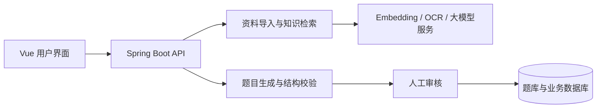

<p align="center"></p>

# AI 软考培训系统

面向软考备考场景的 AI 应用，连接资料导入、知识检索、答疑、练习生成与人工审核。

**作者：严峰 · 企业项目实习期间独立开发 · 公开源码展示版**

[后端代码](backend/platform-application/src/main/java/com/aiexam/app) · [前端代码](frontend/src) · [测试](backend/platform-application/src/test) · [本地运行](#本地运行) · [公开范围](#公开范围与当前限制)

## 项目背景与我的工作

在实习期间独立开发，供 4 人内部试用。我的工作覆盖资料处理与检索、带来源的 AI 答疑、结构化出题与人工审核流程，以及前后端集成。

这份仓库提供可供阅读和构建的代码快照。内部试用规模来自作者项目经历，不代表公开版的性能基准；本次发布未重新进行企业环境的完整验收。

## 重点看什么

| 能力 | 实现入口 | 设计重点 |
| --- | --- | --- |
| 知识增强答疑 | [AI 助手模块](backend/platform-application/src/main/java/com/aiexam/app/aiassistant) | OCR、切片、向量化与混合检索，结合题目和历史生成带来源的回答 |
| 练习生成与审核 | 同目录的 `AiQuestionGenerationService` / `AiQuestionGenerationAdminController` | 校验模型输出，保存待审核草稿，经人工审核进入题库 |
| 基础能力与工程边界 | [模块说明](backend/README.md) | 多模块 Spring Boot、统一接口、数据校验与数据库迁移 |
| 前端交互 | [Vue 源码](frontend/src) | 资料、答疑、练习和审核界面 |

## 技术栈

Java 17 · Spring Boot 3.3 · LangChain4j · Vue 3 · TypeScript · MySQL · Redis · Qdrant



## 本地运行

### 推荐运行方式：Docker Compose

项目实际以名为 `ai` 的 Docker Compose 项目运行，并非单独启动默认 H2 配置的 JAR。组合配置如下：

- `docker-compose.dev.yml`：MySQL、Redis、后端与前端。
- `docker-compose.knowledge-gpu.yml`：OCR、Embedding 与 Qdrant；其中 OCR / Embedding 需要 NVIDIA GPU 环境。

后端容器名为 `ai-exam-backend-dev`，前端为 `ai-exam-frontend-dev`，数据库为 `ai-exam-mysql-dev`。

**已有本地环境**可在原项目目录启动已创建的服务（保留既有镜像和数据卷）：

```powershell
docker compose -p ai -f docker-compose.dev.yml -f docker-compose.knowledge-gpu.yml start
```

启动后访问：

| 入口 | 地址 |
| --- | --- |
| Web | http://127.0.0.1:5173 |
| API | http://127.0.0.1:8000 |
| MySQL | 127.0.0.1:33307 |
| OCR / Embedding | 127.0.0.1:18080 / 18081 |

`start` 启动已有容器，不重建镜像、不初始化新环境。首次从 GitHub 克隆的使用者需要先准备自己的环境变量、符合当前版本的 MySQL 表结构及合成演示数据，再使用相同配置执行 `up --build`。公开版没有包含企业已有数据卷和内部初始化数据，不能把作者电脑上已有环境的启动方式当作全新环境的一键安装。

### 源码构建与开发

准备 JDK 17、Maven 3.9，以及 Node.js 22.19 / npm 10.9。在 `backend` 目录执行：

```powershell
mvn -DskipTests package
```

2026-10-15 已在隔离副本完成七个 Maven 模块打包（跳过测试）。`docker/backend/Dockerfile` 也从源码构建 JAR，无需作者本地的预编译产物。

前端本地开发可在 `frontend` 目录执行：

```powershell
npm ci
npm run dev
```

Vite 默认将 `/api` 转发到本机 `8000`。模型、OCR、Embedding、Qdrant 与 MySQL 的配置应与选定的 Docker / 开发环境保持一致。

### 测试与运行验证范围

```powershell
# 后端，backend 目录
mvn test

# 前端，frontend 目录
npm test
npm run build
```

MySQL 测试必须使用独立的 `_test` 数据库及 `MYSQL_TEST_*`，详见 [后端说明](backend/README.md)。本次公开整理验证了源码打包，并核对现有 Docker 的 Compose 来源、持久化 MySQL 配置和保留日志中的后端成功启动记录；未启动或重建现有容器，未重新验收全部业务。

单独用默认 H2 配置启动 JAR 的隔离测试出现 `AUTH_V13_SCHEMA_NOT_READY`。这反映该独立启动方式缺少认证表结构，**不代表 Docker / MySQL 环境存在同一故障**。新环境的合成数据初始化与完整复现说明仍待补齐。

## 演示与验证材料

当前先公开源码和运行入口；截图、短视频与同版本评估材料将在脱敏整理后补充。推荐演示闭环：导入自有示例资料 → 提问并查看引用 → 生成题目草稿 → 人工审核。

## 公开范围与当前限制

- 不包含企业数据库、真实用户记录、凭证、教材原文、第三方题库、上传附件及预编译 JAR。
- Docker 是项目实际运行方式；公开仓库不包含作者已有 MySQL 数据卷，新环境需准备表结构与合成演示数据，完整复现流程仍待补齐。
- `docker/backend/Dockerfile` 从源码构建 JAR，无需作者本地的 `backend/deploy` 产物。
- 原始数据与第三方服务未配置时，相关能力不可用；请提供具有使用权限的样例数据。
- 本仓库展示源码，不代表向第三方数据和企业素材授予使用许可。

## 目录导航

`backend/` 后端与测试 · `frontend/` Vue 前端 · `docker/` 容器构建 · `scripts/` 工程脚本
